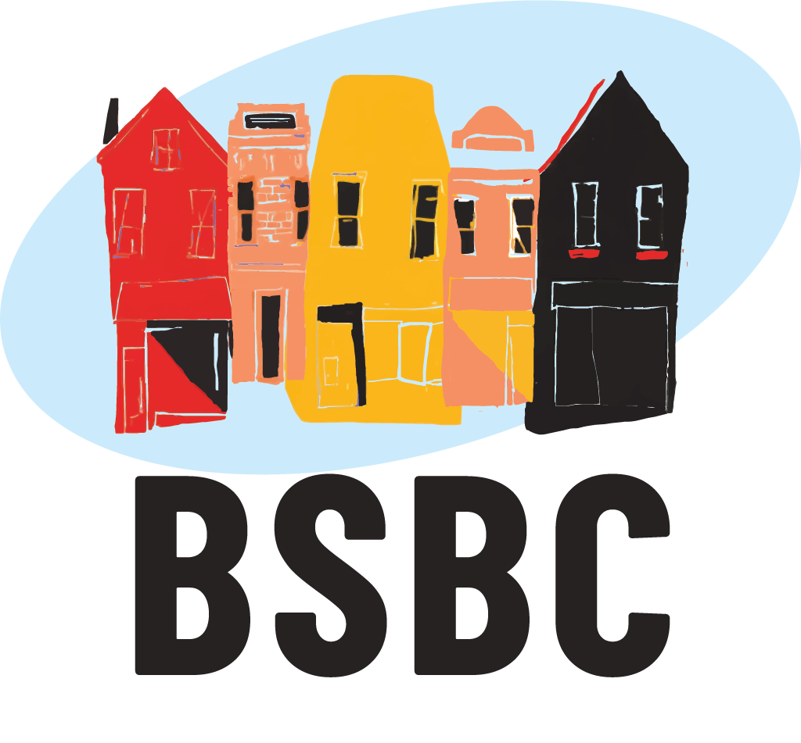

<a id="readme-top"></a>

<br />
<div align="center">
  <a href="https://www.bmoresmallbusinessrights.com">
    
  </a>

  <h3 align="center">Baltimore Small Business Bill of Rights</h3>

  <p align="center">
    The campaign website of the B'More Small Business Coalition.
    <br />
    <a href="https://www.bmoresmallbusinessrights.com"><strong>Go to the website »</strong></a>
    <br />
    <br />
    <a href="https://github.com/tannermobley/Bmore-Small-Business-Rights/issues/new?labels=bug">Report a problem</a>
    &middot;
    <a href="https://github.com/tannermobley/Bmore-Small-Business-Rights/issues/new?labels=enhancement">Request a change</a>
  </p>
</div>

<details>
  <summary>Table of Contents</summary>
  <ol>
    <li><a href="#about-the-project">About the Project</a></li>
    <li><a href="#built-with">Built With</a></li>
    <li><a href="#getting-started">Getting Started</a></li>
    <li><a href="#usage">Usage</a></li>
    <li><a href="#contributing">Contributing</a></li>
    <li><a href="#license">License</a></li>
    <li><a href="#contact">Contact</a></li>
    <li><a href="#acknowledgments">Acknowledgments</a></li>
  </ol>
</details>

## About the Project

The B'More Small Business Coalition website. 

The website address is [bmoresmallbusinessrights.com](https://www.bmoresmallbusinessrights.com).

<p align="right">(<a href="#readme-top">back to top</a>)</p>

## Built With

* HTML, CSS, and JavaScript. The project does not use a framework.
* [GitHub Pages](https://pages.github.com) for the website host.
* [Google Fonts](https://fonts.google.com) for the Barlow Condensed and Lexend fonts.
* Google Apps Script and Google Forms for the petition and the volunteer form.
* The [BGE Electricity Report](https://bge-report.districtdata.co) from District Data.

<p align="right">(<a href="#readme-top">back to top</a>)</p>

## Getting Started

### Prerequisites

You must have these items:

* Git
* A web browser
* Python 3 (optional). Use it to start a local web server.

### Installation

1. Clone the repository.
   ```sh
   git clone https://github.com/tannermobley/Bmore-Small-Business-Rights.git
   ```
2. Go to the project folder.
   ```sh
   cd Bmore-Small-Business-Rights
   ```
3. Start a local web server.
   ```sh
   python3 -m http.server 8000
   ```
4. Open `http://localhost:8000` in your web browser.

<p align="right">(<a href="#readme-top">back to top</a>)</p>

## Usage

### Project files

| File or folder | Content |
| --- | --- |
| `index.html` | The main campaign page. |
| `links.html` | The link page for social media profiles. |
| `assets/` | Site images (favicon, banners, flyers). |
| `assets/businesses/` | Supporter business logos for the carousel. |
| `CNAME` | The custom domain for GitHub Pages. |

### Change the text

1. Open `index.html`.
2. Find the text that you want to change.
3. Change the English text in the `data-lang="en"` element.
4. Change the Spanish text in the `data-lang="es"` element.

> **Note:** Always change the English text and the Spanish text together.

### Add a supporter logo

1. Put the logo file in the `assets/businesses/` folder.
2. Use a PNG file with a transparent background.
3. Make sure that the logo shows clearly on a white background.
4. Open `index.html`.
5. Find the `logo-track` element.
6. Add a line for the logo in the first list:
   ```html
   <div class="logo-slot"></div>
   ```
7. Add a line for the logo in the second list:
   ```html
   <div class="logo-slot" aria-hidden="true"></div>
   ```

> **Note:** The second list makes the logo scroll continuously. Do not remove it.

### Publish a change

GitHub Pages publishes the `main` branch automatically.
Merge your change into `main` to publish it.

<p align="right">(<a href="#readme-top">back to top</a>)</p>

## Contributing

We welcome contributions from the community.

1. Fork the repository.
2. Make a new branch.
   ```sh
   git checkout -b feature/your-change
   ```
3. Commit your change.
   ```sh
   git commit -m "Add your change"
   ```
4. Push the branch.
   ```sh
   git push origin feature/your-change
   ```
5. Open a pull request.

<p align="right">(<a href="#readme-top">back to top</a>)</p>

## License

This project does not have a license file at this time.

<p align="right">(<a href="#readme-top">back to top</a>)</p>

## Contact

B'More Small Business Coalition

* Website: [bmoresmallbusinessrights.com](https://www.bmoresmallbusinessrights.com)
* Instagram: [@bmoresmallbizrights](https://instagram.com/bmoresmallbizrights)

<p align="right">(<a href="#readme-top">back to top</a>)</p>

## Acknowledgments

* [Best-README-Template](https://github.com/othneildrew/Best-README-Template)
* All the Baltimore businesses that support the coalition and volunteers that make all of this great work possible. 

<p align="right">(<a href="#readme-top">back to top</a>)</p>
